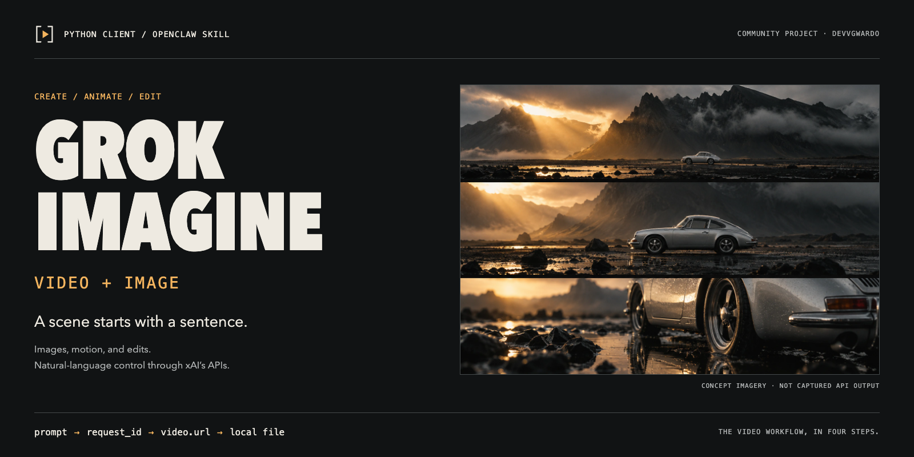
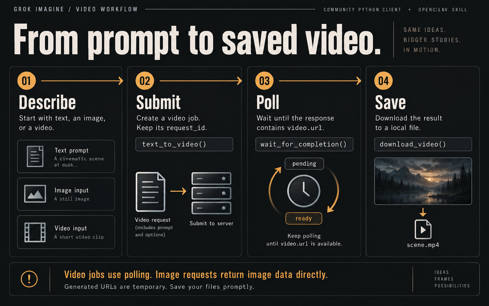
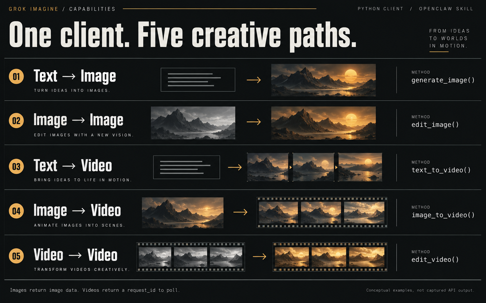

# Grok Imagine Video + Image

<p align="center">
  
</p>

<!-- Rendered from docs/banner.html at 1600x800. See docs/BRAND.md. -->

**A scene starts with a sentence.**

A community Python client and [OpenClaw](https://docs.openclaw.ai) skill for [xAI's Grok Imagine APIs](https://docs.x.ai/developers/model-capabilities). Generate an image, animate a still, or create and edit video with natural-language instructions.

[Quick start](#quick-start) · [How it works](#how-it-works) · [Creative paths](#five-creative-paths) · [Usage](#usage) · [OpenClaw setup](#openclaw-skill-installation) · [MIT license](LICENSE)

xAI remains the default backend. An optional Atlas Cloud client is also included
for the same Grok Imagine workflows when `ATLASCLOUD_API_KEY` is configured.

## Features

- **Text-to-Image** — Generate images from text (up to 10 variations)
- **Image Editing** — Edit images with natural language instructions
- **Text-to-Video** — Generate video clips from text descriptions
- **Image-to-Video** — Animate static images into motion video
- **Video Editing** — Apply filters, speed changes, color grading, and effects
- **Video Job Polling** — Track API jobs with status checks and progress callbacks; the wait helper blocks until completion or timeout
- **OpenClaw Integration** — Drop-in skill for Discord, Telegram, and WhatsApp bots

## Quick Start

You need Python 3.8+, `requests`, and your own xAI API key. API use is subject to your xAI account's billing and limits.

1. **Clone the project and install the dependency.**
   ```bash
   git clone https://github.com/DevvGwardo/grok-imagine-video.git
   cd grok-imagine-video
   python3 -m pip install requests
   ```

2. **Get an API key** at [console.x.ai](https://console.x.ai/) and set it in your local environment. Do not commit your key.
   ```bash
   export XAI_API_KEY="your-key-here"
   ```

3. **Run from the repository root.** This example uses the skill's client in `scripts/`.
   ```python
   import os
   from scripts.grok_video_api import GrokImagineVideoClient

   client = GrokImagineVideoClient(api_key=os.environ["XAI_API_KEY"])

   # Submit a video job, wait for its result, and save the file.
   job = client.text_to_video(
       "Slow camera move over a volcanic landscape at sunrise",
       duration=10,
   )
   final = client.wait_for_completion(job["request_id"])
   client.download_video(final, "outputs/scene.mp4")
   ```

The wait helper polls synchronously. Generation time varies; this example does not return immediately with a finished video.

## How it works

<p align="center">
  
</p>

1. **Describe.** Start with a text prompt, source image, or source video.
2. **Submit.** `text_to_video()`, `image_to_video()`, and `edit_video()` return a `request_id`.
3. **Poll.** Pass that ID to `wait_for_completion()`, or check it with `get_job_status()`. A completed response contains `video.url`.
4. **Save.** Pass the completed response to `download_video()` and save a local file. Generated URLs are temporary.

Image generation and image editing return image data directly, without the video-job polling step.

## Five creative paths

<p align="center">
  
</p>

| Input → output | Method | What it does |
|---|---|---|
| Text → Image | `generate_image()` | Create images from a description |
| Image → Image | `edit_image()` | Edit a source image with instructions |
| Text → Video | `text_to_video()` | Start a video generation job |
| Image → Video | `image_to_video()` | Animate a still image |
| Video → Video | `edit_video()` | Request changes to an existing clip |

The visuals are conceptual AI-generated illustrations, not captured Grok Imagine output or performance benchmarks. This is an independent community project, not an official xAI client.

## Usage

### Optional Atlas Cloud backend

Atlas Cloud jobs are asynchronous for both images and videos. Verify the current
model IDs and input schema in the [Atlas Cloud model catalog](https://www.atlascloud.ai/models)
before overriding a model, then submit each generation request only once.

```bash
export ATLASCLOUD_API_KEY="your-key-here"
```

```python
import os

from scripts.atlas_cloud_grok import AtlasCloudGrokClient

atlas = AtlasCloudGrokClient(os.environ["ATLASCLOUD_API_KEY"])
job = atlas.text_to_video(
    "A golden retriever running through a sunny meadow",
    duration=10,
)
final = atlas.wait_for_completion(job["request_id"])
atlas.download_output(final, "output.mp4")
```

The Atlas client supports text-to-image, image editing, text-to-video,
image-to-video, and video editing. It never retries generation POSTs; only the
prediction GET is repeated with a bounded timeout.

### xAI client examples

These examples reuse `client` from the quick start. See the [skill API reference](references/api_reference.md) for more detail, or the [extended client reference](docs/API_REFERENCE.md) for the additional helpers in `src/`.

### Image Generation

```python
result = client.generate_image(
    prompt="A collage of London landmarks in a stenciled street-art style",
    n=4,                       # 1-10 variations
    aspect_ratio="16:9",
    response_format="b64_json" # or "url" (default)
)
```

### Image Editing

```python
result = client.edit_image(
    image_url="https://example.com/photo.jpg",
    prompt="Change the sky to a dramatic sunset"
)
```

### Text-to-Video

```python
result = client.text_to_video(
    prompt="Slow pan across a cyberpunk cityscape at night",
    duration=10,          # 1-15 seconds
    aspect_ratio="16:9",  # 16:9, 9:16, 1:1, 4:3, 3:4, 3:2, 2:3
    resolution="720p"     # 480p (faster) or 720p (higher quality)
)
```

### Image-to-Video

```python
result = client.image_to_video(
    image_url="https://example.com/landscape.jpg",
    prompt="Make the clouds drift slowly across the sky",
    duration=10
)
```

### Video Editing

```python
result = client.edit_video(
    video_url="https://example.com/clip.mp4",
    edit_prompt="Add a warm sunset filter and slow down to 50% speed"
)
```

## OpenClaw Skill Installation

Install from this checkout. The repository contains the skill source; a prebuilt `.skill` archive is not required.

```bash
dest="${OPENCLAW_STATE_DIR:-$HOME/.openclaw}/skills/grok-imagine-video"
mkdir -p "$dest"
cp -R SKILL.md README.md scripts references "$dest/"
openclaw gateway restart
```

Run the copy commands from the repository root. Configure `XAI_API_KEY` in the environment used by your OpenClaw gateway, not only in an unrelated terminal.

Then tell your bot things like *"Generate a video of a sunset over the ocean"* or *"Edit this image, make it look like a watercolor painting"*.

## API Limits

These are the values documented by this client. Provider availability and account limits can change; check [xAI's current documentation](https://docs.x.ai/developers/model-capabilities) before relying on them.

| Constraint | Value |
|---|---|
| Images per request | 1-10 |
| Video duration | 1-15 seconds |
| Video editing input limit | 8.7 seconds |
| Video resolution | 480p or 720p |
| Rate limit | 60 requests/min |
| Concurrent jobs | 15 per account |

Image and video URLs are **temporary** — download promptly after generation.

## Prompt Tips

- **Be descriptive** — *"A collage of London landmarks in a stenciled street-art style"*
- **Specify style/lighting** — *"Watercolor painting of a mountain lake at dawn with golden hour lighting"*
- **Include camera direction** for videos — *"Slow pan from left to right over a mountain range"*
- Use `n=4` to explore image variations; use 480p for fast video iteration, 720p for finals

## Project Structure

```
grok-imagine-video/
├── scripts/
│   ├── grok_video_api.py      # Python client library
│   └── atlas_cloud_grok.py    # Optional Atlas Cloud backend
├── references/
│   └── api_reference.md       # Skill API documentation
├── src/
│   └── grok_video_api.py      # Extended client, including long-video helpers
├── tests/                    # Mocked client tests
├── docs/                     # API reference, brand assets, and visual preview
├── SKILL.md                   # OpenClaw skill definition
├── CHANGELOG.md               # Version history
└── README.md
```

## Requirements

- Python 3.8+
- [`requests`](https://pypi.org/project/requests/) library
- xAI API key ([console.x.ai](https://console.x.ai/))
- Atlas Cloud API key (optional, for `AtlasCloudGrokClient`)
- [OpenClaw](https://docs.openclaw.ai) (only for chatbot integration)

## License

[MIT](LICENSE).

## Credits and visual assets

- Community client and skill: [DevvGwardo](https://github.com/DevvGwardo).
- Image and video APIs: [xAI](https://docs.x.ai/developers/model-capabilities).
- Agent integration: [OpenClaw](https://docs.openclaw.ai).

See the [brand guide](docs/BRAND.md) for editable sources, image provenance, and rendering instructions. Open `docs/brand.html` locally for the responsive visual preview. Branding changes do not change client or skill behavior.
